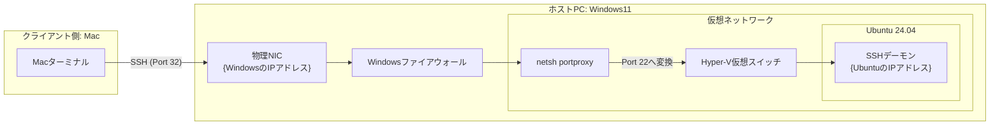
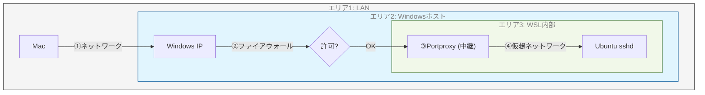
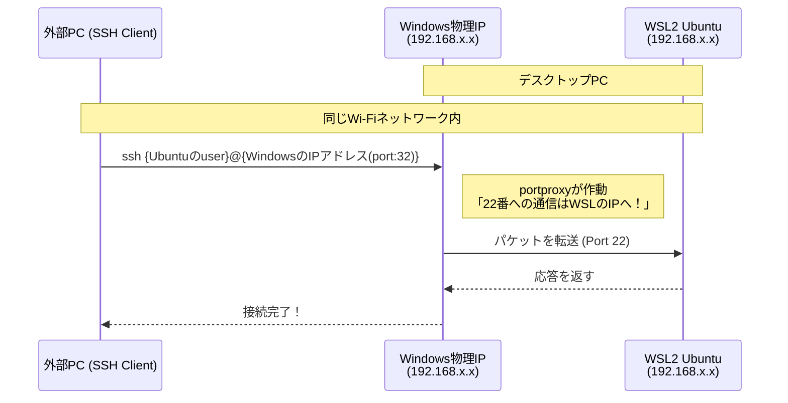
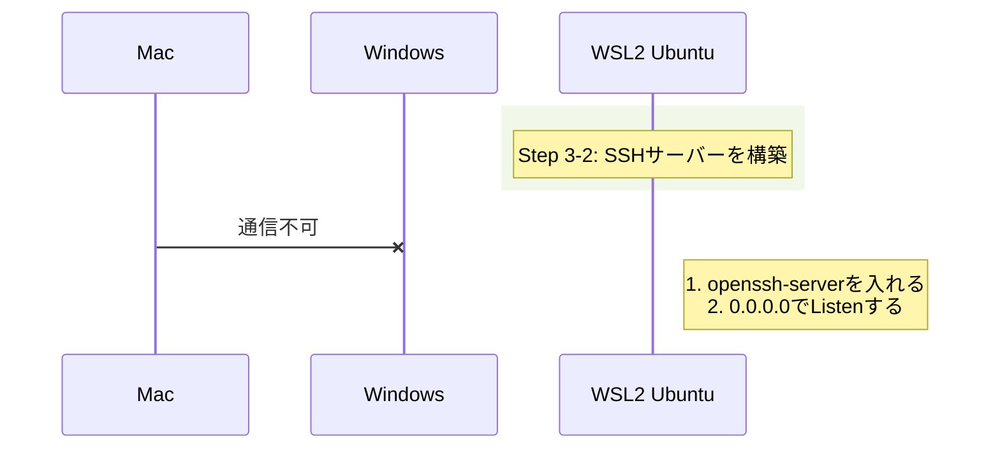
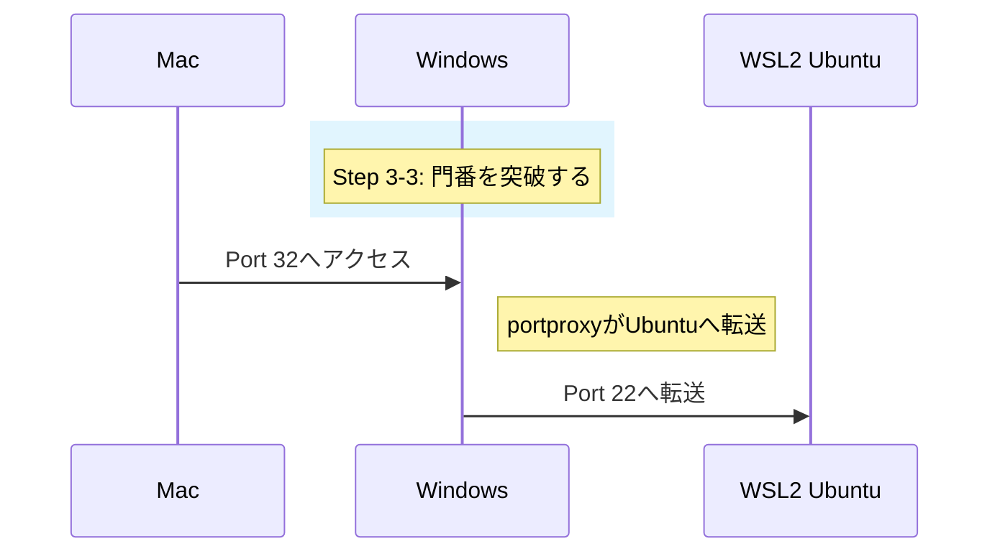
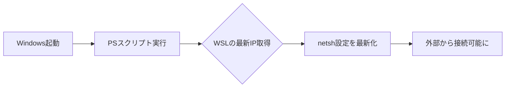

# 1. はじめに：何をしたいのか？
この記事では、WindowsデスクトップPC（WSL2）に構築したUbuntu環境へ、手元のクライアントPC(Mac)からシームレスにSSHを行うための手順を記載しています。

WSL2は、通常のUbuntuをベアメタルで起動するのとは異なり、WindowsというホストOSの内部で「仮想ネットワーク（NAT）」という膜に包まれて動いています。そのため、外部から見ると「二重のルーター」の中にターゲットがいるような状態であり、デフォルトではアクセスが一切遮断されています。これらを一つずつ突破してアクセスできるようにしていきましょう。



## 背景
当初、メモリ64GBのマシンにProxmoxを入れ、VMを立てまくる予定でした。しかし、最新GPUを積んだことで「Debian系の標準ドライバが対応しておらず、モニター出力ができない」という事態に遭遇。

次期メジャーアップデートで対応するまでの間、Windows環境でリソースをフルに活かして大規模計算を行いたいと考えたのが、この環境構築の始まりです。

## 想定環境
- ホストPC
  - OS : Windows11
  - メモリ : 64GB
  - 仮想化有効済み
- クライアントPC
  - OS : M2 Mac Book Air

## なぜうまくいかなかったのか
WSL2（Ubuntu）は、Windows内部の**仮想ネットワーク（NAT）**上で動いています。
パケットの流れを整理すると、以下の「4つの壁」を突破する必要があります。



# 2. 要点まとめ（三行で）

- Ubuntu側: SSHサーバーを立て、外部受付（0.0.0.0）を許可する
- Windows側: 届いたパケットをWSLに流す「ポート転送」と「ファイアウォール開放」を行う
- 自動化: WSLのIPは起動のたびに変わるため、スクリプトで自動追従させる




# 3. セットアップ手順
## 3-1 : WindowsにWSLをインストール
`wsl --install` でサクッとUbuntuを入れることができます。
最近のWondowsはこれだけで環境が整うようになったので、非常に簡単！

## 3-2 : Ubuntu側のSSH準備


まずはUbuntu内部でSSHサーバの構築を行います。
```bash:ホストPC_ubuntu
sudo apt update && sudo apt install openssh-server
```
`/etc/ssh/sshd_config` を編集し、以下の設定を有効にする
- `ListenAddress 0.0.0.0` : すべてのIPからの接続を待つ設定
- `PasswordAuthentication yes` : アクセス時にパスワードを要求する設定

設定が終わったら、サービスを起動開始
```bash:ホストPC_Ubuntu
sudo service ssh start
```
- ※ハマりポイント: 設定変更後は sudo service ssh restart を忘れずに

## 3-2: Windows側の設定(WindowsからUbuntuへのアクセスを有効にする)

Windowsに届いたSSh通信を内部のUbuntuへ「パス」を設定します。
PowerShell(管理者)で以下を実行する

```powershell:ホストPC_Windows-PowerShell(管理者)
netsh interface portproxy add v4tov4 listenport=32 listenaddress=0.0.0.0 connectport=22 connectaddress=[WSLのIP]
```

:::note warn
### なぜポートを22にしないのか？
Windowsには標準で「OpenSSH Server」という機能があり、これが動いているとポート22を占有してしまいます。WSL2への転送と衝突するのを防ぐため、あえて「32」や「2222」などの別番号を窓口にするのが安全な「定石」です。
今回私は32で行っています。
:::

併せて、Windowsファイアウォールに穴を空けます。

```powershell:ホストPC_Windows-PowerShell(管理者)
New-NetFirewallRule -DisplayName "WSL2 SSH" -Direction Inbound -Action Allow -Protocol TCP -LocalPort 32
```

## 3-3 : 動的IPアドレスへの対応（自動化）

WSLのIPアドレスはWindowsを再起動するたびに変わります。そこで、起動時に最新のIPを取得して netsh を更新するスクリプトを作成し、タスクスケジューラに登録します。

```ps1:ホストPC_/C/Scripts/wsl_ssh_setup.ps1
$wsl_ip = (wsl hostname -I).Trim().Split(" ")[0]
netsh interface portproxy delete v4tov4 listenport=32 listenaddress=0.0.0.0
netsh interface portproxy add v4tov4 listenport=32 listenaddress=0.0.0.0 connectport=22 connectaddress=$wsl_ip
```




# 4. 快適な接続環境を整える
- SSH公開鍵認証 : 鍵を共有し、パスワード入力を省略化する
```bash:クライアントPC
ssh-copy_id -p 32 {Ubuntuのuser}@{WindowsのIPアドレス}
```
- `~/.ssh/config` : sshコマンドの省略化
  - 仮に`wsl`という名前をでアクセスできるようにすると`ssh -p 32 {Ubuntuのuser}@{WindowsのIPアドレス}`となるところを`ssh wsl` だけで繋がるようにできる
  - 

# 5. 遭遇したトラブルと解決策（ここが一番重要！）
- ネットワークプロファイル
  - Windowsのネットワークが「パブリック」だと、どんなに頑張っても弾かれる。必ず「プライベート」にすること
- ncコマンドによる切り分け
- sshで繋がらない場合は、`nc -zp {WindowsのIPアドレス} {Port}` を実行
  - Timeoutだとファイアウォール周りの設定が不十分の可能性
  - RefusedならSSHサーバか転送設定の不備の可能性

# 6. 結びに
これでクライアントPCからWSL上のUbuntu環境へシームレスにアクセスできるようになります。
