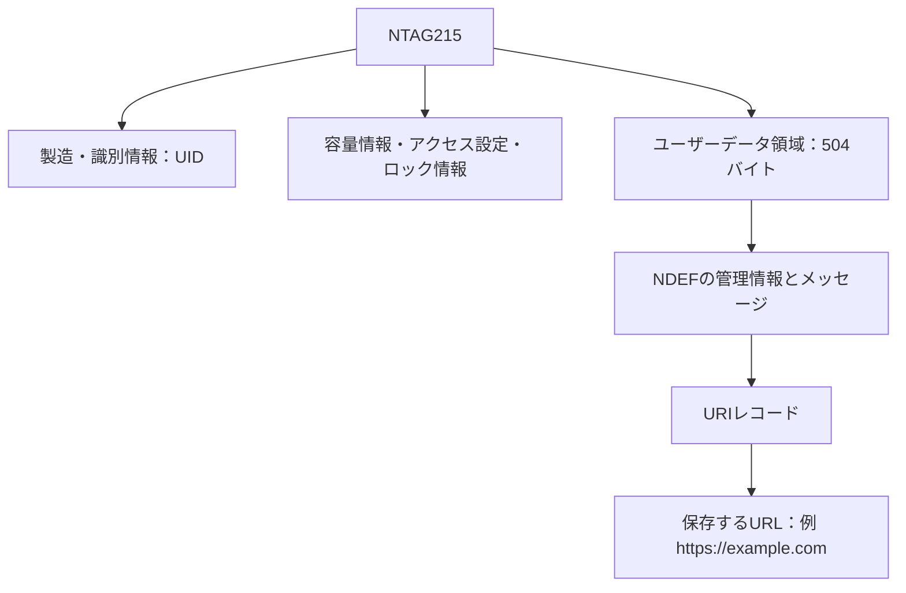
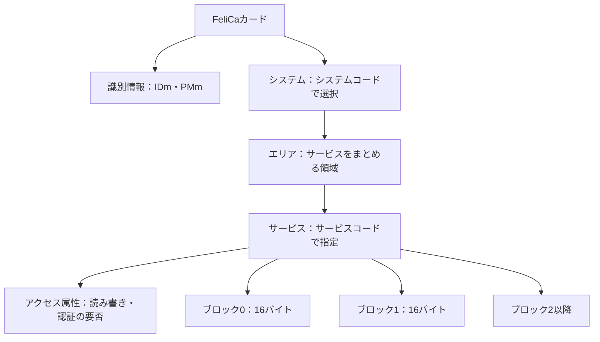
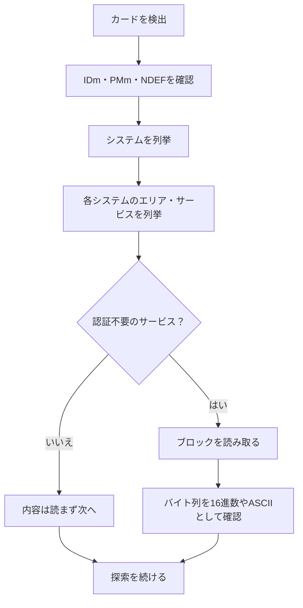
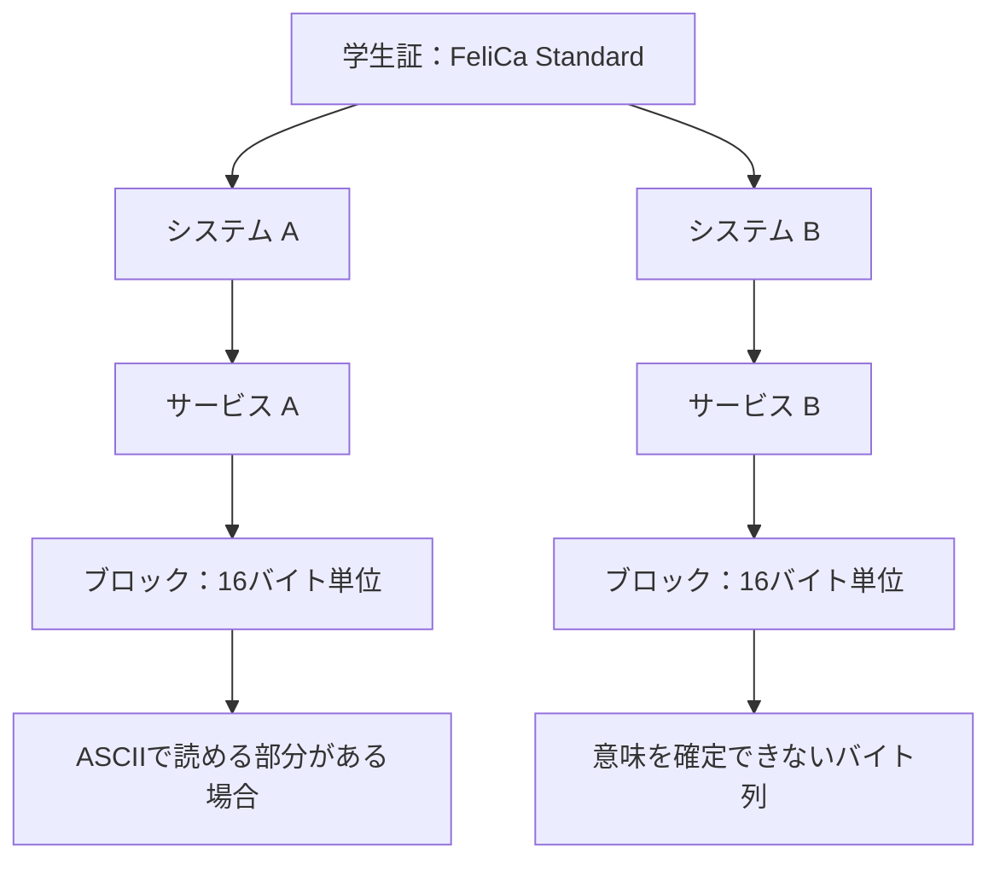
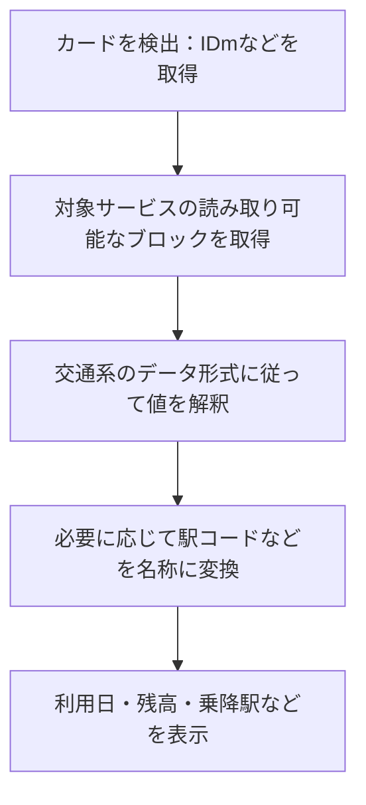
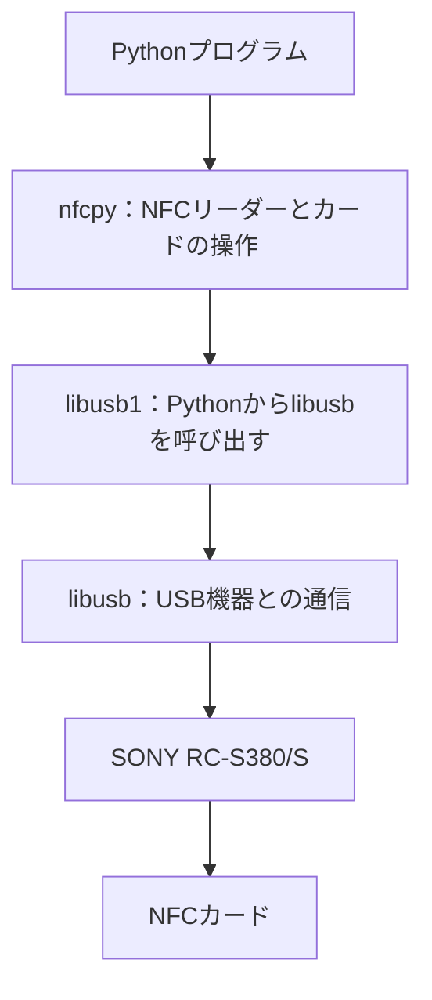

USB接続のNFCリーダー「RC-S380」を購入したので、Pythonで手元のNFCカードを読み取ってみました。

調べてみると、個人向け・業務用のモデルに加え、ソニーが提供するSDKやオープンソースのライブラリなど、複数の選択肢が見つかります。初めて触る場合、手元の機器で何を用意すればよいのか、少し分かりにくく感じました。

この記事では、ソニーの有料SDKを使わずに読み取れた方法と、取得したデータの見方をまとめます。Pythonのコードを保存し、ターミナルから実行できる方を想定しています。NFCの知識は前提にしません。

NTAG215・自分の学生証・PASMOの読み取り結果を取り上げ、カードごとの違いと、取得したデータから分かる範囲を説明します。自分が所有するカード、または読み取りの許可を得たカードを使用してください。記事に掲載する識別情報や文字列の例は、伏せ字または架空の値に置き換えています。

詳細調査用のプログラムはGitHubリポジトリ「demo-NFC」でも公開しています。[^demo-nfc] 本文ではまず短いコードで読み取りを試し、さらに調べたい場合にGitHub版を使う構成です。GitHub版では、カード固有の情報を既定で伏せ字にします。

## TL;DR
- MacとRC-S380/Sで、Pythonの`nfcpy`を使ってNFCカードを読み取れた
    - ソニー製の有料SDKは使用せず、USBアクセスには`libusb`を利用した
- NTAG215からはUIDとNDEFに記録されたURL、学生証からはIDmと認証不要の一部領域のデータを取得できた
    - PASMOはIDmなどの識別情報まで確認し、利用履歴の読み取り・解析は行っていない
- 詳細調査用コードはGitHubで公開している。[^demo-nfc]
    - 記事の最小コードは学習用、GitHub版は調査用として使い分ける

## I. 検証環境

| 項目 | 検証環境 |
|:-:|:-:|
| PC  | M2 MacBook Air（macOS 26.6.2） |
| NFCリーダー  | SONY RC-S380/S（PaSoRi）<br>USB認識名：`RC-S380/S`<br>nfcpyのデバイス指定：`usb:054c:06c1`  |
| Pythonバージョン  | 3.14.0  |
| パッケージ管理  | uv 0.9.7  |
| NFCライブラリ  | nfcpy 1.0.4  |
| Python側のUSBライブラリ  | libusb1 3.4.0  |
| 読み取り対象  | NTAG215、自分の学生証、PASMO  |

<details><summary>Macへの対応について</summary>

RC-S380の付属セットアップガイドはWindows向けです。本記事は上記のMac環境でnfcpyを使って確認した手順です。

今回のMacでは動作しましたが、nfcpyのドキュメントではmacOSが定期テスト環境に含まれていません。メーカー提供ソフトの対応OSと、この記事のnfcpyによる動作実績は区別してください。

参考：[^nfcpy-overview]

</details>


### RC-S380について
今回購入したNFCリーダーはこちらです。購入時の価格は5,031円でした。[^amazon-rcs380]


Amazonの商品ページでは「PaSoRi RC-S380/S」と表記されていましたが、届いた箱には「RC-S380」と記載されていました。実際にUSB機器の情報を確認すると「RC-S380/S」と認識されていたため、この記事ではRC-S380/Sとして扱います。

## II. RC-S380がMacから認識されているかを確認

1. RC-S380をMacのUSBポートに接続する
2. ターミナルでUSB機器の認識情報を確認する
    - 次のコマンドは、RC-S380に該当する行とその後の24行を表示する

    ```bash:ターミナル
    ioreg -p IOUSB -l -w 0 | grep -A 24 'RC-S380'
    ```

3. 実行結果を確認する
    ```bash:実行結果
    "USB Product Name" = "RC-S380/S"
    "USB Vendor Name" = "SONY"
    "idVendor" = 1356
    "idProduct" = 1729
    ```
    - `idVendor`：メーカーを識別する番号（Vendor ID）
        - 10進数の`1356`は16進数で`054c`となり、ソニーを表す
    - `idProduct`：製品を識別する番号（Product ID）
        - 同じメーカーの製品を区別するための番号
        - 10進数の`1729`は16進数で`06c1`となる

    ここでは、箱の表記「RC-S380」ではなく、USBの認識名として「RC-S380/S」が表示されています。

4. nfcpyで使うデバイス指定を確認する
    - `ioreg`の`idVendor`と`idProduct`をそれぞれ16進数にすると、`054c:06c1`となる
    - nfcpyでのデバイス指定は、これに`usb:`を付けた`usb:054c:06c1`

    ```bash:16進数の確認
    printf '%04x:%04x\n' 1356 1729
    ```

    ```text:実行結果
    054c:06c1
    ```


## III. Pythonの実行環境を用意する
1. `uv`と`libusb`を用意する
    - `command -v uv`や`brew list --versions libusb`で導入状況を確認する
    - インストールされていない場合は、Homebrewで導入する
        ```bash
        brew install uv libusb
        ```

2. uvプロジェクトを作成する[^uv]
    ```bash:ターミナル
    uv init --python 3.14 nfc-card-demo
    cd nfc-card-demo
    ```

    - `uv run python main.py`を実行し、作成されたサンプルプログラムのメッセージが表示されることを確認する

3. `nfcpy`を追加する[^nfcpy-started]
    ```bash:ターミナル
    uv add nfcpy==1.0.4
    ```
    - `uv run python -m nfc`を実行し、以下のように表示されれば`nfcpy`の導入を確認できる
        ```text
        This is the 1.0.4 version of nfcpy run in Python 3.14.0
        ```

<details><summary>GitHubのサンプルコードを使う場合</summary>

本文の手順は、自分でPythonファイルを作成する方法です。一方、詳細調査用コードをそのまま使いたい場合は、リポジトリを取得して依存関係を準備できます。[^demo-nfc]

ターミナルで、上記の`nfc-card-demo`とは別の場所に移動して実行します。Homebrewで`uv`と`libusb`を導入済みであることを前提とします。

```bash
git clone https://github.com/ari-show/demo-NFC.git
cd demo-NFC
uv sync --locked
uv run python main.py
```

`uv sync --locked`は、リポジトリにある`uv.lock`を確認し、ロックファイルを変更せずに環境を同期します。`main.py`はFeliCaのシステム・サービスも調査するプログラムです。コードの内容やオプションは第VI章の付録で紹介します。

</details>

## IV. PythonでNFCカードを読み取る
1. `main.py`を次の内容に書き換える[^nfcpy-tag]

    ここで扱うのは読み取りの基本を理解するための最小コードです。**カードのUID・IDmやNDEFの内容をそのまま表示する**ため、ターミナル出力をそのまま公開しないでください。GitHub版とはプログラムの内容と既定の表示方法が異なります。
    ```python:main.py
    import time
    import nfc

    DEVICE = "usb:054c:06c1"  # 前章で確認したnfcpyのデバイス指定

    def on_connect(tag):
        print("カード種類:", tag.type)
        print("詳細:", tag)
        label = "IDm" if tag.type == "Type3Tag" else "UID"
        print(f"{label}:", tag.identifier.hex().upper())

        ndef = tag.ndef
        if ndef is None:
            print("NDEFは取得できませんでした")
        else:
            print("NDEFの長さ:", ndef.length, "バイト")
            for record in ndef.records:
                print("保存データ:", record)

        return False

    def main():
        try:
            with nfc.ContactlessFrontend(DEVICE) as reader:
                print("リーダー:", reader)
                print("カードをかざしてください。最大60秒待ちます", flush=True)
                deadline = time.monotonic() + 60
                tag = reader.connect(
                    rdwr={"on-connect": on_connect},
                    terminate=lambda: time.monotonic() >= deadline,
                )
                if not tag:
                    print("カードを取得できずに終了しました")
        except KeyboardInterrupt:
            print("読み取りを中断しました")
        except (OSError, nfc.tag.TagCommandError, ValueError) as exc:
            print("読み取りエラー", exc)

    if __name__ == "__main__":
        main()
    ```

2. `main.py`を実行する
    ```bash
    uv run python main.py
    ```
    - 待機メッセージが出たら、カードをリーダー中央に置く
        - カードへ書き込みは行わず、1枚取得したら終了する
        - URLを取得してもブラウザを自動で開くこともない
3. 実行結果を確認する
    - 今回はURLをNDEFとして保存したNTAG215を読み取りました。識別情報は架空の値に置き換えています。
    ```
    カード種類: Type2Tag
    詳細: Type2Tag 'NXP NTAG215' ID=XXX
    UID: XXX
    NDEFの長さ: 16 バイト
    保存データ: NDEF Uri Record ID '' Resource 'https://example.com'
    ```

ここでは、UIDとURLが別々の情報として取得されていることに注目してください。

- **UID**：タグのICを識別する番号
- **URL**：タグのユーザーデータ領域にNDEF形式で記録された情報

NTAG215では、通常のデータ書き換えで製造時のUIDが変更されるわけではありません。一方、書き込みが許可されたユーザーデータ領域にあるNDEFメッセージは、対応する書き込み操作によって更新できます。今回のプログラムは読み取り専用で、書き込みは行いません。

以降では、同じリーダーでNTAG215以外のカードを読み取ると、何が異なるのかを見ていきます。

<details><summary>カードが読み取れない・想定した結果が出ない場合</summary>

次の点を確認してください。

- RC-S380/SとRC-S380/Pでデバイス指定を取り違えていないか
- `libusb`本体がインストールされているか
- 他のアプリケーションがリーダーを使用していないか
- 実行環境からUSB機器にアクセスできるか
- USBケーブルやUSBポートを変えても同じ結果になるか
- 対象カードがnfcpyとリーダーの対応する方式か

</details>

## V. 読み取ったデータの意味を理解する

### 今回確認できた情報と読み取りの範囲

| 確認したいもの | 今回の結果・記事の範囲 |
| --- | --- |
| カードの識別番号（UID / IDm） | NTAG215・学生証・PASMOで取得できた |
| カードに保存されたURL | NTAG215からNDEFとして取得できた |
| 学生証に入っている文字列 | 認証不要の一部領域から取得できた。意味までは断定しない |
| 認証必須の領域 | 今回のコードでは読まない |
| PASMOなどの駅名・残高 | 今回は実機でカードの識別情報まで確認。交通系データの読み取り・解釈は未実施 |

NFCは、機器とカードを近づけて通信するための技術です。通信できた後に、どの情報を取り出せるかはカードごとに異なります。

### NTAG215：UIDとNDEFは別の情報

NTAG215のユーザーデータ領域は504バイトで、メモリーは4バイト単位の「ページ」で扱います。[^ntag215]

URLをNDEFとして保存した場合、概念的には次のようになります。



NDEFは、URLやテキストなどのデータを共通の形式で表現する仕組みです。**どの種類のデータなのかを示す情報と、その内容**をレコードにまとめます。読み取り側はその種類を見て、URLなどとして解釈できます。[^nfcpy-ndef]

504バイトのすべてをURLの文字に使えるわけではありません。管理情報などにも容量を使います。また、NTAG215のデータが必ずNDEFであるわけでもありません。

### FeliCa：学生証やPASMOは同じ構造？

自分の学生証を読み取ったときは、nfcpyでは `Type3Tag`、製品名は `FeliCa Standard` と表示されました。先ほどのNTAG215とは別の方式です。

| 比較 | 今回のNTAG215 | FeliCa方式のカード |
| --- | --- | --- |
| 通信方式 | NFC-A | NFC-F |
| 識別番号 | UID | IDm |
| データを扱う基本単位 | ページ：4バイト | ブロック：16バイト |
| 今回のデータの扱い方 | NDEFからURLを取り出す | サービスを指定してブロックを読む |

なお、「NDEFとFeliCaのどちらか一方しか使えない」という意味ではありません。FeliCaにもNDEFを扱う仕組みはありますが、今回の学生証からNDEFは取得できませんでした。

FeliCaには、システム、エリア、サービスという仕組みがあります。ファイルシステムに例えると、エリアはフォルダー、サービスはファイルのような役割を持ちます。ただし、PCのファイルシステムと同じものではありません。[^felica]



読み取り側は、システムを選択し、サービスとブロック番号を指定してデータを要求します。サービスには認証不要のものと、鍵による認証が必要なものがあります。また、異なるサービスが同じデータ領域を参照する場合もあります。

PASMOなどの交通系カードでは、交通サービス用のデータ形式を解釈する必要があります。NDEFのURLを読むコードだけでは、乗車日・駅名・残高などは表示できません。リーダーが通信できることに加えて、ソフト側がデータの読み方を知っている必要があります。

### 学生証のデータ構造を調べる

ここまで説明した「システム・エリア・サービス・ブロック」は、FeliCaの論理的なデータ管理の仕組みです。ただし、**どのサービスに何の情報が保存されているかは、学生証ごとに異なり得ます。**

自分の学生証では、nfcpyから`Type3Tag`（FeliCa Standard）として認識され、調査用プログラムで複数のシステムとサービスを確認できました。一部の認証不要サービスでは16バイト単位のブロックを読み取れましたが、得られた文字列の意味までは特定していません。

調査で分かったことを、3つの段階に分けて整理します。

| 段階 | 分かること | 今回の確認範囲 |
| --- | --- | --- |
| FeliCaの論理構造 | システム・エリア・サービス・ブロックの関係 | 公開仕様をもとに説明できる |
| 今回の学生証での配置 | どのシステムやサービスが存在し、どのブロックが読めるか | 実機で一部を確認できた |
| アプリケーションデータの意味 | 取得した値が学籍番号・日付などの何を表すか | 発行元の仕様が不明なため断定できない |

調査用プログラムは、サービスの属性を調べたうえで、認証不要のサービスに限って`Read Without Encryption`を実行します。認証が必要な領域にアクセスするものではありません。[^demo-nfc-main]

以下は処理の概念図です。



今回の学生証でも、このような構造をたどってデータにアクセスできました。個々のシステムコード・サービスコードや実データは、発行元や用途を推測する手掛かりになり得るため掲載しません。次の図も**説明のための抽象図であり、実際の学生証のシステム数や配置を再現したものではありません。**



ここで重要なのは、**「読めたバイト列」と「その意味が分かったこと」を分ける**ことです。以降では、公開に適した架空のデータを使って出力の見方を説明します。調査コードの実行方法は第VI章の付録に掲載します。

### 16進数と文字列の読み方

調査中に理解が進んだのが、16進数と文字の対応でした。以下は、実際の個人情報を使わずに作った説明用データです。

```text
[0001] 39 30 30 30 30 30 30 30 31 00 32 30 39 39 30 31 | 900000001.209901
[0002] 30 32 00 00 00 00 00 00 00 00 00 00 00 00 00 00 | 02..............
```

1行の読み方は次のとおりです。

| 部分 | 意味 |
| --- | --- |
| `[0001]` | ブロック番号1（このプログラムでは10進数表示） |
| `39 30 30 …` | 読み取った各バイトを16進数で表示 |
| `900000001.209901` | 同じバイト列を印字可能なASCII文字として表示 |

例えば、16進数の `39` はASCIIの文字 `9`、`30` は文字 `0` です。「数値の9をそのまま保存したバイト `09`」とは異なります。

上の例を文字としてつなげると、次のようになります。

```text
ブロック1：900000001 [00] 209901
ブロック2：02 [00] …

連結後：900000001 [00] 20990102 [00] …
```

上の例からは、`900000001`と`20990102`という2つの文字列候補を取り出せます。後者は、16バイトのブロック境界をまたいでいます。これは架空の出力例であり、実際の学生証の格納値や桁数を表すものではありません。

この例では、値が`00`のバイトが`.`と表示されています。実際のデータにピリオドが保存されているわけではありません。このプログラムでは、印字できないASCII範囲外のバイトを`.`に置き換えるため、正確な値は左側の16進数で確認します。

また、`20990102`は日付のように見えても、データ仕様を知らなければ日付とは断定できません。学生証の情報がすべてASCII文字列で保存されているとも限りません。数値・日付・フラグなどがバイナリ形式で格納されている場合もあり、値の意味を特定するには発行元の仕様が必要です。

### FeliCaの出力：IDm・PMm・システムコード

PASMOを読み取ったとき、次のような情報が表示されました。

```text
カード種類: Type3Tag
詳細: Type3Tag ID=[伏せ字] PMM=[伏せ字] SYS=0003
IDm: [伏せ字]
NDEFは取得できませんでした
```

それぞれの項目は、次のように読めます。

| 表示 | 意味 | 公開時の扱い |
| --- | --- | --- |
| `Type3Tag` | nfcpyが認識したFeliCa系カードの種類 | 個人を示す情報ではない |
| `ID` / `IDm` | FeliCaのカード識別情報。`詳細` の `ID` と `IDm` は同じ値 | カードを区別・関連付ける手掛かりになるため伏せる |
| `PMM` / `PMm` | FeliCaの製造パラメーター情報 | 氏名や利用履歴ではない。記事では省略または伏せてもよい |
| `SYS=0003` | nfcpyが表示したFeliCaのシステムコード | この値だけから個人や利用履歴は分からない |
| NDEFの取得結果 | この読み取りではNDEFメッセージを取得できなかった | カード内に他のデータがないという意味ではない |

IDmは氏名や学籍番号そのものではありませんが、カードを識別する値として扱い、記事・画像・ログを公開するときは伏せるのが安全です。PMmやシステムコードから、この出力だけで氏名・乗車駅・残高・利用日時が分かるわけではありません。[^sony-tech]

### PASMOでは何が違う？

PASMOもFeliCaを使う身近なカードです。今回の環境ではカードを検出し、IDm・PMm・システムコードを取得できました。一方、短い読み取りコードではNDEFを取得できず、交通系サービスのデータや利用履歴は読み取っていません。

PASMOの公式案内では、利用日・利用内容・SF残額などを残額履歴として確認できます。また、ソニーのSFCard Viewer 2には、PASMOの利用履歴や残高を表示する機能が案内されています。[^pasmo][^sfcard]

このような表示には、カードから読み取ったバイト列を交通系のデータ形式として解釈する処理が必要です。学生証の例のようにASCII文字を探すだけでは、日付や残高、駅名を表示できるとは限りません。

| カード | データの解釈の例 | この記事での扱い |
| --- | --- | --- |
| NTAG215 | NDEFを解釈し、URLを取り出す | 実機で確認 |
| 今回の学生証 | 認証不要のブロックを読み、文字列候補を探す | 実機で確認。文字列の用途は未確定 |
| PASMO | 交通系の形式に合わせて、取得データを日付・残高などとして解釈する | 実機でカード検出と識別情報を確認。履歴の読み取り・解析は未実施 |

同じFeliCaでも、今回の学生証のサービスコードや文字列の配置を、そのままPASMOに当てはめることはできません。**カードと通信する処理に加えて、そのカードのデータ形式に合った解釈が必要**という点がポイントです。

<details>
<summary>「データを読む」と「履歴を表示する」の違い</summary>



これは処理の概念図で、PASMOのメモリー配置図ではありません。付録のプログラムはカードの識別情報と認証不要のブロックを表示する調査用のもので、交通系データの解釈や駅名への変換は行いません。

なお、SFCard Viewer 2は表示機能の参考として挙げています。同ソフトの現行版はWindows向けで、2026年5月の更新でRC-S380がサポート外になっています。この記事のMac・nfcpyの構成で使用するソフトではありません。[^sfcard]

</details>

## VI. 補足：リーダーのモデル・SDK・ライブラリ

### RC-S380とRC-S380/Sの違い

ソニーはRC-S380を個人向け、RC-S380/Sを業務用途専用モデルとして案内しています。また、個人向けRC-S380のセットアップガイドには、ソフト上で`RC-S380/P`を選ぶ説明があります。[^sony-models][^sony-setup]

nfcpyの対応機器一覧には、次の2つの指定が掲載されています。

| nfcpyの機種表記 | デバイス指定 | この記事での確認範囲 |
| --- | --- | --- |
| RC-S380/P | `usb:054c:06c3` | 対応一覧に掲載。今回の実機検証は未実施 |
| RC-S380/S | `usb:054c:06c1` | 今回確認したUSBの認識名・IDと一致し、カード読み取りを確認 |

出典：[^nfcpy-devices]

製品の用途区分だけでは、nfcpyで使えるかどうかは判断できません。手元の機器のVendor ID・Product IDを確認し、対応一覧のデバイス指定と照らし合わせます。`/P` は同一覧には掲載されていますが、定期テスト対象ではありません。

### 有料SDKは必要？

この記事で行った読み取りには、ソニーの有料SDKを使っていません。Pythonライブラリのnfcpyからlibusbを通じてリーダーを操作しました。

SDKは「ソフトウェア開発キット」のことで、アプリケーションを作るためのライブラリや資料などをまとめたものです。ソニーの製品ページには別売SDKのほか、評価用の無償キットも案内されています。「SDK」という言葉が出てきても、今回のような読み取りに必ず購入が必要とは限りません。[^sony-sdk]

ただし、nfcpyがソニーのSDKの全機能を代替するわけではありません。今回確認したのは、自分のカードの識別情報、NDEF、FeliCaの認証不要領域です。

### nfcpy・libusb1・libusbの役割

今回の構成は次のとおりです。



ここで紛らわしかったのが、`libusb1` と `libusb` の違いです。

| 名前 | 役割 | 今回の導入方法 |
| --- | --- | --- |
| `nfcpy` | NFC機器を操作し、対応するカード形式を扱う | `uv add` |
| `libusb1` | Pythonからlibusbを呼び出す橋渡し | nfcpyの依存関係として入る |
| `libusb` | OSを介してUSB機器と通信する本体 | Homebrewで別途導入 |

実際に今回のPython環境を確認すると、`libusb1` にはlibusb本体が同梱されておらず、Homebrewの `libusb-1.0.dylib` が読み込まれていました。

つまり、このMacでは **nfcpyをインストールすることと、libusb本体を用意することは別の作業**でした。nfcpyの導入資料でも、USBアクセスにはlibusbが必要と説明されています。[^nfcpy-install]

### 付録：GitHubの詳細調査用プログラムを使う

第V章で説明したFeliCaの調査コードは、GitHubリポジトリの`main.py`に公開しています。[^demo-nfc-main] 本文の第IV章にある短い`main.py`とは**別のプログラム**です。詳細調査を試す場合は、以下のようにGitHub版を取得して実行してください。

```bash
git clone https://github.com/ari-show/demo-NFC.git
cd demo-NFC
brew install uv libusb
uv sync --locked
uv run python main.py --device usb:054c:06c1
```

既定の`usb:054c:06c1`は今回のRC-S380/S用です。nfcpyの対応一覧にはRC-S380/P（`usb:054c:06c3`）もありますが、本記事では実機検証していません。[^nfcpy-devices]

GitHub版の主な機能は次のとおりです。

| 対象 | GitHub版での扱い |
| --- | --- |
| UID・IDm・PMm | 取得するが、既定では伏せ字で表示 |
| NDEF | 取得できる場合はレコード種別を表示。内容は既定で非表示 |
| FeliCaのシステム・エリア・サービス | 列挙し、既定では件数のみ表示 |
| 認証不要のブロック | 読み取り、既定では件数・文字列候補数を表示 |
| 認証必須のサービス | 内容を読み取らない |
| PASMOの利用履歴や残高 | データ形式の解析を行わない |

識別情報やブロック内容を実際に確認する場合は、**自分のカードだけを対象に**`--reveal`を指定します。

```bash
uv run python main.py --device usb:054c:06c1 --reveal
```

`--reveal`ではIDm、システムコード、サービスコード、文字列候補なども表示されます。実際の出力を記事・Issue・チャットやログに貼り付けないように注意してください。GitHub版のREADMEにもプライバシーに関する注意事項があります。[^demo-nfc]

その他のオプションは次のとおりです。

| オプション | 既定値 | 内容 |
| --- | --- | --- |
| `--device` | `usb:054c:06c1` | nfcpyのデバイス指定 |
| `--timeout` | `180` | カード待機時間（秒） |
| `--max-blocks` | `32` | 1サービスあたりの最大読み取りブロック数 |
| `--reveal` | 無効 | 詳細な値を伏せずに表示 |

処理には、FeliCaのシステム・サービス調査を約30秒で打ち切る制限や、1システムあたり最大256件の探索上限があります。1枚読み取ったら終了し、カードへの書き込みは行いません。

**記事は処理の背景や取得データの意味を解説し、GitHubは詳細調査コードと更新履歴を提供する**という役割分担です。コードの最新版を確認したい場合は、リポジトリを参照してください。

## VII. まとめ

MacとRC-S380/Sを使い、ソニーの有料SDKを購入せずに、PythonのnfcpyからNTAG215のUIDとURL、学生証・PASMOの識別情報を読み取れました。学生証については、認証不要の一部ブロックからデータを取得できました。

今回の実験で特に重要だったのは、**カードと通信してデータを取得できることと、そのデータの意味を説明できることは別**だという点です。NTAG215ではNDEFのURLを解釈できましたが、学生証のバイト列については発行元の仕様がなく、用途までは特定していません。また、PASMOの利用履歴の解析も対象外です。

初めての方は第IV章の短いコードから試してみてください。より詳しく調べたい場合は、詳細調査用コードと実行方法をまとめたGitHubリポジトリも参照してください。[^demo-nfc]

### 参考資料

[^nfcpy-overview]: [nfcpy：対応機器と検証環境](https://nfcpy.readthedocs.io/en/latest/overview.html)
[^nfcpy-started]: [nfcpy：導入とカードの読み取り](https://nfcpy.readthedocs.io/en/latest/topics/get-started.html)
[^nfcpy-tag]: [nfcpy：カード操作API](https://nfcpy.readthedocs.io/en/latest/modules/tag.html)
[^ntag215]: [NXP：NTAG213/215/216](https://www.nxp.com/products/NTAG213_215_216)
[^felica]: [ソニー：FeliCaのしくみ](https://www.sony.co.jp/Products/felica/about/scheme.html)
[^pasmo]: [PASMO：残額履歴の確認](https://www.pasmo.co.jp/ic-card/use/history/)
[^sfcard]: [ソニー：SFCard Viewer 2](https://www.sony.co.jp/Products/felica/consumer/app/sfcardviewer2.html)
[^uv]: [uv：プロジェクト管理](https://docs.astral.sh/uv/guides/projects/)
[^amazon-rcs380]: [Amazon：購入したRC-S380/Sの商品ページ](https://www.amazon.co.jp/dp/B00VR1WARC)
[^nfcpy-ndef]: [nfcpy：NDEFの読み書き](https://nfcpy.readthedocs.io/en/latest/topics/get-started.html#read-and-write-tags)
[^sony-tech]: [ソニー：FeliCa技術情報](https://www.sony.co.jp/Products/felica/business/tech-support/)
[^sony-models]: [ソニー：RC-S380の製品区分](https://www.sony.co.jp/Products/felica/consumer/support/faq/detail/263.html)
[^sony-setup]: [ソニー：RC-S380セットアップガイド](https://www.sony.co.jp/Products/felica/consumer/support/setup/RC-S380.html)
[^nfcpy-devices]: [nfcpy：対応機器一覧](https://nfcpy.readthedocs.io/en/latest/overview.html#supported-devices)
[^sony-sdk]: [ソニー：RC-S380の開発環境](https://www.sony.co.jp/Products/felica/business/products/reader/RC-S380.html)
[^nfcpy-install]: [nfcpy：インストール手順](https://nfcpy.readthedocs.io/en/latest/topics/get-started.html#installation)

[^demo-nfc]: [GitHub：ari-show/demo-NFC](https://github.com/ari-show/demo-NFC)
[^demo-nfc-main]: [GitHub：詳細調査用 main.py](https://github.com/ari-show/demo-NFC/blob/main/main.py)
