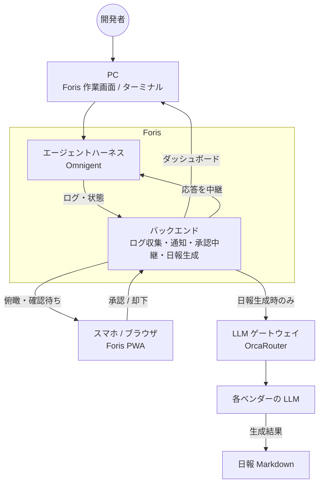
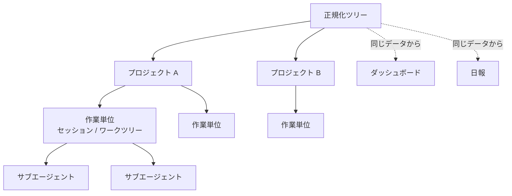
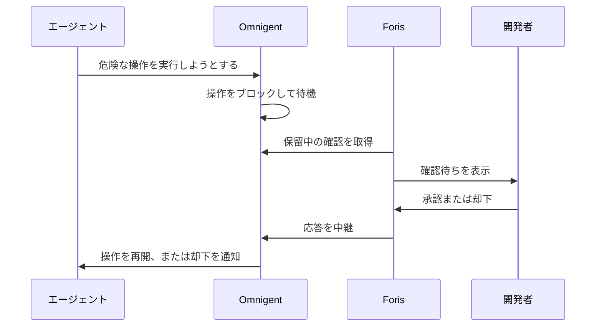
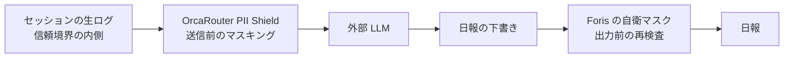
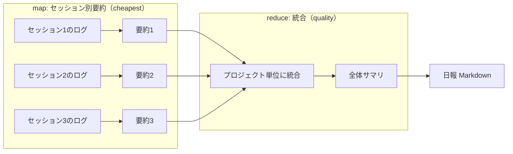

本記事は、AI HACK ハッカソン 2026 に提出したプロダクト **Foris** の技術者向け開発記です。

Foris が解く課題と、ダッシュボード・承認ゲート・日報という 3 つの機能は、プロダクト紹介記事で説明しています。本記事では、その機能を信頼できる形で成立させるための設計判断に絞ります。

プロダクト紹介記事:

Foris は、複数の AI エージェント開発を運用するために、次の機能を提供します。

- **ダッシュボード**: 複数プロジェクト・複数セッションの状態を横断して把握する
- **承認ゲート**: 確認待ちの操作をスマホから承認・却下する
- **日報**: セッションログを統合し、成果・経緯・モデル別貢献を Markdown に残す

この実装では、次の制約を最初に置きました。

- セッション一覧はフラットで、プロジェクト情報や親子関係が欠けることがある
- 日報には自然な文章が必要だが、モデル別コストやエラーといった事実を生成に任せられない
- 日報生成は外部 LLM を使うため、秘密情報・原価・上流障害を設計で扱う必要がある
- 承認や破壊的操作の検知は、説明可能かつテスト可能でなければならない

以降の設計を読むために、この記事では次の言葉を使います。

- **エージェントハーネス**: AI エージェントの実行、セッション管理、ツール呼び出し、承認待ち、ログ記録を担う基盤。Foris では Omnigent を利用しています。
- **LLM ゲートウェイ**: 複数の LLM 呼び出しを 1 か所へ集約し、ルーティングやマスキングを適用する中継層。Foris では OrcaRouter を利用しています。
- **Foris バックエンド**: ハーネスから取得したログを正規化し、ダッシュボード・承認 UI・日報に変換する層です。

## 1. 設計制約と責務の境界

設計の境界は明確にしました。Omnigent はエージェント実行・統一ログ・確認待ちを担い、Foris はログを正規化してプロダクト機能へ変換します。OrcaRouter は日報生成時の LLM 経路だけを担い、マスキング、モデルの振り分け、原価計測を一か所へ集約します。

この分離により、「エージェントの状態を読む」「日報を生成する」「人間の判断を戻す」をそれぞれ独立にテストできます。特に、OrcaRouter を全エージェント通信の代理にしているわけではなく、日報生成時の外部 LLM 呼び出しに責務を限定している点が重要です。

## 2. 不揃いなセッションログを、共通の読み取りモデルへ変換する

Omnigent は、複数エージェントを並走させる統一ログ API と、危険操作の前に人間へ確認を求める仕組みを持つ OSS です。Foris ではこの基盤を取り込み、エージェントそのものを作り直すのではなく、ログの統合・可視化・日報化に集中しました。

取り込み後の改変は、ブランディング、参加導線、Foris バックエンドとの接続が中心です。Apache 2.0 の LICENSE / NOTICE は保持し、改変内容は履歴で追える状態にしています。

### フラットなログを 3 階層に正規化する

Omnigent のセッション一覧はフラットなため、そのまま表示すると並列作業の全体像が見えません。Foris は、ログをプロジェクト・作業単位・サブエージェントの 3 階層に整理します。

この単一データモデルからダッシュボードと日報の両方を生成するため、現在の状態と後から振り返る記録がずれません。プロジェクトに明示的に紐づかないセッションは、作業ディレクトリのパスを手がかりにまとめ、Git を利用している場合はブランチ名を補助情報として使います。Git は必須入力ではありません。

### 一覧と詳細を分け、形の揺れを境界で吸収する

ログソースが返すデータは、常に同じ形とは限りません。プロジェクト一覧は配列、`data` 配下の配列、単一オブジェクトのいずれでも受け取れるようにし、正規化の境界で ID と表示名の対応表へ変換します。

また、一覧では軽量な状態を取得し、承認内容・エラー理由・モデル別利用量のような情報はセッション詳細から補います。ここには正確性と呼び出し回数のトレードオフがあります。現状は日報の根拠を優先して詳細を取得していますが、多数セッション時の N 件詳細取得は今後最適化すべき課題です。

承認待ちは、一覧にある `pending_elicitations_count` を「要対応」の確実なシグナルとして使い、詳細 API から質問文や承認対象を取得します。表示のための推測ではなく、状態を表す構造データを優先する方針です。

## 3. 人間の承認を、安全な中継として実装する

危険操作の停止そのものは Omnigent の elicitation（エージェントが人間の回答を待つ確認機構）を利用し、Foris は保留中の確認をスマホへ出し、応答を返す中継を担います。

スマホ側の操作は承認・却下の 2 択だけに絞りました。自由なテキスト指示を送るよりも、危険な判断だけを安全に処理することを優先しています。

子セッションの確認は、子自身ではなく所有する親セッションへ応答を返す必要があります。このため、確認内容の表示と resolve API の呼び出しで、対象セッション ID を同じものとして扱わないようにしています。承認 UI は単純でも、親子関係を含む状態遷移としては扱う必要があります。

### 破壊的操作のアラートに LLM を使わない

承認待ち以外にも、`rm -rf`、`git reset --hard`、強制 push、`DROP`、`TRUNCATE` などは通知対象です。この判定には LLM ではなく、ツール実行の function call に含まれるコマンド文字列への正規表現照合を使っています。

通知は頻繁に発生しうるため、判定ごとに LLM の利用料を払わないこと、なぜ検知したかを説明できること、テストで再現できることを優先しました。同じ種別の操作を 1 通に畳み、識別子で重複通知も抑止しています。

## 4. OrcaRouter を安全な日報生成経路にする

OrcaRouter は OpenAI 互換 API で複数ベンダーの LLM を呼び出せるルーターです。Foris では、日報生成時の LLM 呼び出しに利用しています。

日報生成でルーターを通すことにより、次の 3 つを 1 つの経路に集約しました。

- **ルーティング**: セッション別の要約は低コストなモデル、全体統合は高品質なモデルへ振り分ける
- **PII Shield**: 日報生成前のマスキングをルーター側でも実施する
- **単価表 API**: 実トークン数とモデル単価から、日報の生成原価を算出する

### PII Shield を送信前、Foris 側マスクを出力前の安全網にする

エージェントログには、エラーメッセージ中のメールアドレスなど、秘匿情報が混ざる可能性があります。日報生成時のプロンプトは OrcaRouter の PII Shield を必ず経由させ、外部 LLM への送信前にマスキングします。これは外部へ出るデータを守る一次防衛です。

Foris 側では、日報を返す直前にメールアドレス、電話番号、マイナンバー、カード番号などを [PII:種別] に置き換えます。これは Shield の設定やモデル出力に依存せず、プロダクトが返す成果物を再検査する二次防衛です。

ただし、正規表現で確実に扱えるのは構造化された値です。自由文に含まれる氏名や住所は、書き方の揺れが大きく、アプリ側の正規表現だけでは取りこぼします。この層は「完全な PII 判定器」ではなく、代表的な漏えいを出力前に防ぐ自衛層です。自由文の検知は OrcaRouter 側の Shield やカスタムリストで補う、という責務分担にしています。

### 日報の生成原価を実測する

日報末尾には、生成にかかった原価を残します。

> この日報の生成原価: $0.0123（実測 / cheapest 62% / quality 38% / 総 45,678 tokens）

原価は推定値ではなく、OrcaRouter の応答に含まれる実トークン数とモデル別の単価表から算出します。単価表は最初の取得後にキャッシュし、並列要約中に同じ表を重複取得しないようロックで保護しています。

単価を引くときは、プロバイダー解決後の応答モデル名ではなく、リクエスト時に指定したモデル ID を使う必要がありました。応答モデル名は単価表に存在しない別 ID になる場合があるためです。単価表を取得できないときは、トークン数は記録したまま原価を 0 として縮退し、「原価を計測できなかった」ことを日報で明示します。

## 5. 日報は map-reduce と事実集計で作る

1 日分のログを一度に要約させると、文脈長とコストが増え、品質も安定しません。Foris では map-reduce（小さな単位へ分割して処理し、最後に統合する方式）の形に分け、まずセッションごとの要約を作り、その後にプロジェクト単位・全体へ統合します。

AI にはログを読みやすい文章にする役割を任せ、モデル別利用量、ツール実行回数、エラーなどの事実は構造データから機械的に集計します。プロンプトには実ログの抜粋を渡し、ログにないことを推測で書かないよう指示します。長いログでは、依頼内容が現れやすい先頭と結果が現れやすい末尾を優先して残します。

これは「LLM の出力を検証する」より前に、LLM が決めてよい情報と決めてはいけない情報を分ける設計です。文章の流暢さは生成で補い、帰属・利用量・原価・エラーといった監査可能な情報はデータモデルから出すことで、日報を読む人が根拠をたどれるようにしています。

map の単位は独立しているため、将来的には並列化できます。ただし現時点の実装は、外部 API への負荷と失敗時の扱いを単純に保つため、セッションごとに逐次処理しています。セッション数が増えた場合は、同時実行数の上限、再試行、原価集計の整合性を合わせて設計したうえで並列化する予定です。

## 6. 外部依存なしで、境界の振る舞いを検証する

日報の品質は、外部 API が常に正しく応答する前提では検証できません。LLM クライアントは Protocol（実装を差し替えられるインターフェース）として抽象化し、テストでは決定的な MockLLM と `httpx.MockTransport` を使って、ネットワーク接続なしに境界の振る舞いを確認します。

たとえば、ルーティングのテストでは、`cheapest` が `auto` をリクエストすること、`quality` が指定モデルを使うこと、応答の input / output token と単価表から原価が計算されることを検証しています。単価表が 503 を返すケースも用意し、トークン数を残して原価だけを縮退できることを確認しています。

日報生成では、LLM が例外を返すモックを注入し、構造データだけの日報に落ちることを検証します。PII マスク、正規化、承認応答、破壊的操作の検知も、それぞれ外部サービスを呼ばない単体テストとして切り出しています。

## 7. 依存先が不調でも日報の骨格を返す

Omnigent と OrcaRouter に依存するため、いずれかが一時的に利用できなくても、何が起きているかを隠さず、可能な範囲で結果を返すようにしました。

- **LLM が不通でも日報を返す**: 要約呼び出しはセッションごとに失敗を吸収し、失敗した部分には「（要約なし）」と明記する。構造データから集計できる情報は残し、縮退中であることも示す
- **API キーがなくても開発できる**: キー未設定時は決まった応答を返すモックに切り替え、実キーなしで動作確認とテストを行える
- **上流サービスの不調を区別する**: 接続先の問題を「上流のエラー」として扱い、原因不明の 500 エラーに埋もれないようにする

## 8. 現時点の限界と今後の展開

バックエンドは Python 3.13、FastAPI、uv で実装しています。ログ取得・整理・要約の I/O 中心の処理に async を利用し、スマホ側は PWA として提供しています。

デプロイは Railway 上で、Omnigent サービスと Foris サービスを分け、内部ネットワーク経由で接続する構成です。

現時点では、Omnigent の統一ログが主な入力です。素の CLI の JSONL や、利用可能な場合の Git 情報から日報を組み立てる縮退経路は次の課題です。また、日報の根拠を正確に出すためのセッション詳細取得は、多数セッション時に呼び出し回数が増えます。キャッシュ、差分取得、非同期の優先度制御を導入し、俯瞰の応答性と根拠の完全性を両立させる必要があります。

## 9. まとめ

Foris の実装で重視したのは、エージェントログをただ LLM に要約させることではなく、信頼できる運用データへ変換することです。

- 不揃いなセッションログは、正規化してダッシュボードと日報で共用する
- 文章は LLM に任せ、帰属・利用量・エラーは構造データから出す
- 外部 LLM へ出る経路と、プロダクトが返す日報の両方をマスキングする
- 原価・障害・危険操作を、推測ではなく観測可能なデータとして扱う

AI エージェントが長いタスクを担うほど、生成結果だけでなく、その作業をどう観測し、人間がどこで介入し、後からどう検証するかが重要になります。Foris はそのための運用レイヤーとして、エージェント基盤・LLM ゲートウェイ・構造化ログの間をつなぐ設計を目指しました。
