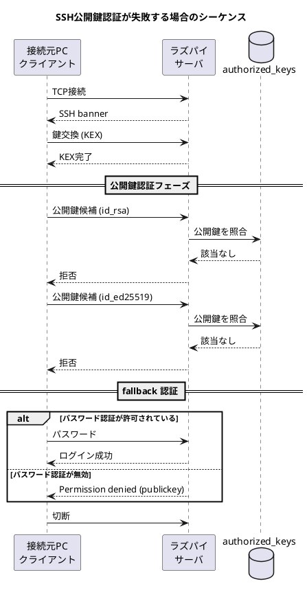

# 1.はじめに
Raspberry Pi に SSH 公開鍵認証で接続しようとしたが、`Permission denied (publickey)` に遭遇しました。同様の事例がないか簡単に記事を探していましたが、パーミッションの説明や鍵の生成方法などが大半でした。
そこで、本記事ではPermission denied の原因切り分けにフォーカスし、調査した結果をまとめたいと思います。

# 2. TL;DR
「ラズパイ(サーバ)側に公開鍵が未登録」なのに、「パスワードログインも無効化」されていたため、認証の入口が完全に封鎖されていました。

## 解決手順
1. ラズパイ(サーバ)側の`/etc/ssh/sshd_config`で一時的に、`PasswordAuthentication yes`を有効化
1. クライアント側で `ssh-copy-id -i ~/.ssh/id_ed25519.pub <Host User>@<Host IP address>`を実行
1. ラズパイ(サーバ)側に追加した鍵が `~/.ssh/authorized_keys`に正しく登録されているか確認したら、`PasswordAuthentication no`に戻す

:::note info
### 環境
- **ラズパイ(サーバ)側**
    - OS : Raspberry Pi OS (Debian Bookworm, 64bit) 
    - Terminal : Bash (既存)
    - Version : OpenSSH_10.0p2
- **クライアント側**
    - OS : Windows11
    - Terminal : Git Bash (WSL2)
    - Version : OpenSSH_9.2p1
    ※ Linuxコマンドを使用しているため、コマンドプロンプトやPowerShellなどは使用していません。
:::

# 3. 症状
- クライアント側からラズパイ(サーバ)側へssh接続を試みた
    ```bash:bash(クライアント)
    $ ssh <Host User>@<Host IP address>
    
    Permission denied (publickey)
    ```
    - 認証で弾かれる
    - ラズパイ(サーバ)側のホスト鍵に関する信頼関係はすでに確立している
        - ラズパイ(サーバ)側の鍵交換は完了している
- 以下のように、公開鍵を合わせて実行
    ```bash:bash(クライアント)
    $ ssh -i ~/.ssh/id_ed25519 <Host User>@<Host IP address>
    
    Permission denied (publickey)
    ```
    - 拒否された

# 4. 問題の切り分け (サーバ or クライアント)
- サーバ、クライアントの両方からログを確認し、問題の発生原因を突き止める
- チェック項目
    - [ ]  authorized_keys ある？
    - [ ] パーミッション適切？
    - [ ] sshd 設定確認
    - [ ] サーバログ確認     
    - [ ] クライアントログ確認
    - [ ] ホームディレクトリは writableか?

## 4-1.クライアントのログの確認 
- `ssh -v`でコマンド実行時のログを確認する
    ```
    ssh -v <Host User>@<Host IP address>
    ```

- 結果
    <details><summary>logの結果を一部修正して掲載しています。</summary>
    
    ```bash
    $ ssh -v <Host User>@<Host IP address>
    
    # 接続確認
    OpenSSH_9.2p1, OpenSSL 1.1.1t  7 Feb 2023
    debug1: Reading configuration data /etc/ssh/ssh_config
    
    # 接続確立
    debug1: Connecting to <Host IP address> [<Host IP address>] port 22.
    debug1: Connection established.
    debug1: identity file ~/.ssh/id_rsa type -1
    debug1: identity file ~/.ssh/id_ecdsa type -1
    debug1: identity file ~/.ssh/id_ed25519 type 3
    debug1: identity file ~/.ssh/id_ed25519-cert type -1
    debug1: Local version string SSH-2.0-OpenSSH_9.2
    debug1: Remote protocol version 2.0, remote software version OpenSSH_10.0p2 Debian-7
    debug1: Authenticating to <Host IP address>:22 as '<Host User>'
    
    # Known_hosts 周り
    debug1: load_hostkeys: known_hosts ファイルを確認
    debug1: Host '<Host IP address>' is known and matches the ED25519 host key.
    
    # 鍵交換
    debug1: SSH2_MSG_KEXINIT sent
    debug1: SSH2_MSG_KEXINIT received
    debug1: kex: algorithm: sntrup761x25519-sha512@openssh.com
    debug1: kex: host key algorithm: ssh-ed25519
    debug1: SSH2_MSG_NEWKEYS sent
    debug1: SSH2_MSG_NEWKEYS received
    
    # 鍵認証
    debug1: Authentications that can continue: publickey
    debug1: Trying private key: ~/.ssh/id_rsa
    debug1: Trying private key: ~/.ssh/id_ecdsa
    debug1: Offering public key: ~/.ssh/id_ed25519
    debug1: Authentications that can continue: publickey
    debug1: Trying private key: ~/.ssh/id_ed25519_sk
    debug1: Trying private key: ~/.ssh/id_xmss
    debug1: Trying private key: ~/.ssh/id_dsa
    debug1: No more authentication methods to try.
    
    <Host User>@<Host IP address>: Permission denied (publickey).
    
    ```
    </details>

- logではどうなっているのか
    ```plantuml
    @startuml
    title SSH接続の流れ（公開鍵認証が失敗するケース）
    
    participant Client as "接続元PC\nクライアント"
    participant Server as " ラズパイ \n サーバ "
    
    Client -> Server: TCPでSSH接続を開始（ポート22）
    Server -> Client: 接続を受け付ける
    
    Client -> Server: 暗号方式の提案
    Server -> Client: 暗号方式を決定
    
    Client -> Server: 鍵交換開始
    Server -> Client: 鍵交換完了
    
    note over Client,Server
      双方で暗号化通信の準備が整う
    end note
    
    Client -> Server: SSHサービス（ログイン）の要求
    Server -> Client: 受け付ける
    
    
    == 公開鍵の確認 ==
    Client -> Server: 公開鍵id_rsaで認証を試行
    Server -> Client: 拒否
    
    Client -> Server: 公開鍵 id_ecdsa で認証を試行
    Server -> Client: 拒否
    
    Client -> Server: 公開鍵 id_ed25519 で認証を試行
    Server -> Client: 拒否
    
    Client -> Server: その他の鍵でも試行
    Server -> Client: 拒否
    
    == 結果 ==
    Server -> Client: 認証失敗（Permission denied）
    
    Client -> Server: 接続を終了
    @enduml
    
    
    ```


## 4-2. サーバ側のログの確認
- サーバでsshに関するログを取得するコマンド
    - ※Raspberry Pi OS Bookwarmでは、`/var/log/auth.log`が存在しないため、`journalctl`で確認する
    - これで、リアルタイムログ表示が可能
    ```bash:ラズパイ
    $ sudo journalctl -u ssh -f
    ```
- クライアントからsshを実行
    ```bash:bash(クライアント)
    $ ssh -i ~/.ssh/id_ed25519 <Host User>@<Host IP address>
    ```
    
- 結果
    ```bash:bash(ラズパイ)
    Connection closed by authenticating <Client User>@<Client IP address> port XXXX [preauth]
    ```
`[preauth]`より、認証前に切断されています。
## 4-3. ログの考察
認証前ですでに通信が切断されていることから、「鍵が一致しない」もしくは、「鍵の未登録」が考えられます。




公開鍵は authorized_keys に存在しなかったため サーバ側で拒否された


# 5. 公開鍵登録のための前提条件
- 公開鍵を送るパーミッションの設定を確認
※便利なコマンド
    ```bash
    $ namei -l ~/.ssh
    
    f: /home/<Client User>/.ssh
    drwxr-xr-x root  root  /
    drwxr-xr-x root  root  home
    drwx------ <Client User> <Client User> <Client User>
    drwx------ <Client User> <Client User> .ssh
    ```

## クライアント側の設定
```bash
chmod 600 ~/.ssh/id_ed25519
chmod 700 ~/.ssh
```

## ラズパイ(サーバ)側の設定
```bash
chmod 700 ~/.ssh
chmod 600 ~/.ssh/authorized_keys
```

# 6. 解決手順
1. 一時的にパスワードログインを許可
    - ラズパイ(サーバ)側で設定を変更する
        ```diff:ラズパイ:/etc/ssh/sshd_config
        - PasswordAuthentication no
        + PasswordAuthentication yes
        ```

2. 鍵を登録
    - クライアント側からラズパイ(サーバ)側へ鍵を登録
        ```bash:クライアント
        $ ssh-copy-id -i ~/.ssh/id_ed25519.pub <Host User>@<Host IP address>
    
        Number of key(s) added: 1 # 成功
        ```
    
    <details><summary>.pubの表記について</summary>

    - `ssh-copy-id -i ~/.ssh/id_ed25519.pub <Host User>@<Host IP address>`という書き方が正しいですが、`.pub`がなくても動作します。
    - `ssh-copy-id -i ~/.ssh/id_ed25519 <Host User>@<Host IP address>`を実行しても勝手に`~/.ssh/id_ed25519.pub`を読み込んでくれます。
    - これによって秘密鍵が漏れることがありません。

    </details>


3. 登録確認
    - 先程登録したクライアント側の`.pub`が存在するか確認
        ```bash:ラズパイ
        cat ~/.ssh/authorized_keys
        ```
4. 再びパスワードログインを無効化
    - `sshd_cofig`の修正
        ```diff:ラズパイ:/etc/ssh/sshd_config
        - PasswordAuthentication yes
        + PasswordAuthentication no
        ```
    - 再起動
        ```bash:ラズパイ
        $ systemctl reload ssh
        ```

# 7.根本問題の分析
今回の根本原因は、以下の構造的ミスにありました。
「公開鍵認証の準備(鍵登録)」を終える前に「fallback の認証経路が閉ざされていた」ということです。
公開鍵を転送する経路が塞がれていたため、サーバは登録されずに鍵が見つからず、認証を拒否していました。
したがって、`Permission denied (publickey)`が出続けていました。

パスワード認証はブルートフォース攻撃などのリスクを抱えるため、最終的には無効化するのが望ましいですが、「公開鍵を登録済みである」ことが前提条件になります。

# 8. まとめ
今回の`Permission denied (publickey)`の原因は、「公開鍵未登録」状況における「パスワード認証OFF」でした。
一時的にパスワード認証を有効化し、`ssh-copy-id`で公開鍵をサーバ側に登録することで解決できました。
よくある記事では、パーミッションの設定についての言及が多かったですが、今回の原因は、複数要因の組み合わせによる発生でした。
`authorized_keys` が存在しても、鍵が正しく入っていない場合があるということを学びました。
今回のトラブルシューティングで、普段何気なく利用している`ssh`コマンドについて深く知るきっかけになりました。また、教科書上の公開鍵暗号方式と現実のフローの間にある暗黙知部分が発生原因だったと感じています。
結果だけみると「それだけかよ」となるものに惑わされていたなと思います。
本記事では問題の切り分けなど、どのようの現象に直面している人に向けて助かるような内容となることを目指しました。
少しでも役に立つといいかなと思います。


# 付録 : 再発防止早見表 
| 症状 | 原因 | 対処　|
|:-:|:-:|:-:|
| `Permission denied (publickey)`  |  鍵未登録・権限誤り | 鍵登録・`chmod`確認 |
| `No such file and directory: authorized_keys`  | `/.ssh/`未作成  | `mkdir -m 700 ~/.ssh` <br> `chmod 700 ~/.ssh`|
|ssh-copy-idの失敗|パスワード認証のOFF|一時的にONにする|


