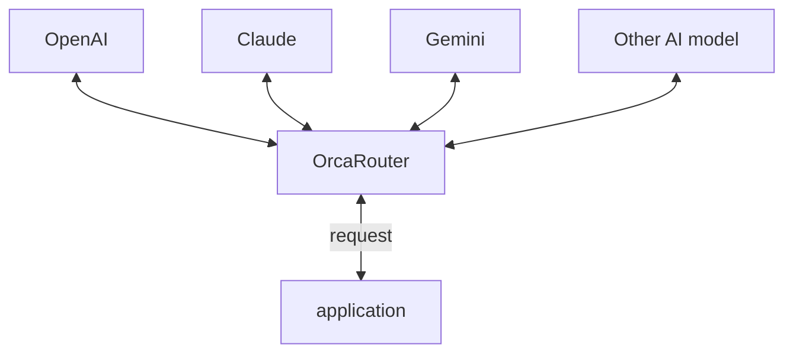

この記事では、OrcaRouterを初めて触る人向けにAPI呼び出しまでを簡単に行うところまで真似できるように執筆します。

## OrcaRouterとは？

> OrcaRouter grades every prompt and routes it intelligently. Frontier-quality AI at up to 40% lower cost. Adaptive routing, load balancing, guardrails, agent firewall, observability, and governance — all through a single OpenAI-compatible endpoint.[^1]

OrcaRouterは、OpenAI・Anthropic・Google Geminiなど複数のLLMプロバイダに、上流プロバイダの原価そのままでリクエストを振り分けられるAPIゲートウェイです。
OpenAI・Anthropic・Google GenAIの各SDKと互換性があり、  `base_url`というURLを書き換えるだけで、既存のコードがそのまま動きます。



本記事では、無料アカウントを作成してから、Pythonで最初のAPI呼び出しを行うまでの最短ルートをまとめます。

課金は一切せず、現在無料枠で使用できるDeepSeekモデルを使用していきます。

### 前提  
- OrcaRouterには「無料モデル」の枠があり、`deepseek/deepseek-v4-flash-free` (50回まで)や、`deepseek/deepseek-v4-pro-free` (10回目) を、受け取りから30日間課金なしで呼び出せます。


:::note info
### ClaudeやGPTのモデルも使いたい場合
DeepSeek以外の、Claude(Anthropic)やGPT(OpenAI)などのモデルを使いたい場合は、OrcaRouterアカウントへの課金が必要です。
マークアップなしで上流プロバイダの料金がそのまま課金されます。

この場合、各AIツールでAPIキーを発行し、OrcaRouterに接続してご利用ください

Claudeモデルを使用する場合は、以下のようなAnthropic SDKをご利用できます。

```python:main.py
import os

from anthropic import Anthropic
from dotenv import load_dotenv

load_dotenv()

def main():
    client = Anthropic(
        base_url = "https://api.orcarouter.ai",
        api_key = os.environ["ORCAROUTER_API_KEY"],
    )

    response = client.messages.create(
        model="anthropic/claude-sonnet-4.6", # モデル名
        max_tokens=1024, # 最大入力トークン数
        messages=[{"role": "user", "content":"Hello OrcaRouter!"}],
    )

    print(response.content[0].text)

if __name__ == "__main__":
    main()
```

:::


# 開発を始める

## 1. アカウントを作成する
- [OrcaRouterのサイト](https://www.orcarouter.ai/register)にアクセスし、サインアップする

## 2. APIキーを発行する
- サインイン後、ダッシュボードのAPI Keysから新しいキーを作成する
    - キーは、 `sk-orca-`から始まる
    - 作成時に「クレジット上限(USD)」「有効期限」を任意で設定できる
    - キーごとのレート制限やモデル許可リストはなく、レート制限はワークスペース単位で適用される


- 設定例
    - 今回の設定例は、安全のため、有効期限などを厳しく設定しています

| カラム | 設定例 |
|:-|:-|
| 名前 | 任意のAPIキー名(`initial-token`)  |
|サイクル上限(USD)|$0.01|
|定期支出上限|毎日|
|モデル制限| (無料枠のモデルはなかったので無記載)|
|ガードレール| アカウントのデフォルト/なし|
|Firewallポリシー| ワークスペースの規定/なし|
|MCPGWへのアクセスを有効化| None|
|このキーにCodexカタログを配信| None|
|プロンプト| なし|
|有効期限| 15分~30分|


:::note warn
発行したキーはこの後の手順で使用するため、控えてください
:::


## 3. 開発環境を準備する
- 本記事では、`uv`というツールを用いて行きます

:::note info
uvは、Pythonのパッケージ管理と仮想環境の両方を管理できるツールです。
Pythonを使用している方は是非使ってみてください
:::


- 任意のディレクトリで初期化してください

```bash
uv init project-name . # 任意ののプロジェクト名を入れてください
uv add openai python-dotenv # ライブラリを追加する
```

- `openai` : 公式OpenAI SDK
    - OrcaRouterはOpenAI 互換のエンドポイントを公開しているため、`base_url`を修正するだけで呼び出せるモデルを変えることができます
- `python-dotenv` : pythonで　`.env` から環境変数を読み込むために使用する

## 4. APIキーを環境変数に設定する
- APIキーはコードに直書きせず、`.env`で管理する
- `.env`を開き、発行したキーを設定する

```.env:.env
ORCAROUTER_API_KEY=sk-orca-...
```

:::note warn
- git管理する場合、`.env`は絶対にコミットしないようにしてください
- `.gitignore`に`.env`を書くことで、上記のことを防げます
:::

## 5. 最小構成のスクリプトを書く
- `main.py`は、通常のOpenAI SDKの使い方と3点だけ異なる
    1. `base_url="https://api.orcarouter.ai/v1" とすること
        - OpenAI SDKは`/v1`を付与しないため、明示的に記述する必要があります。
    2. `api_key`には、先ほど控えていたOrcaRouterのAPIキーを渡してください
    3. `model`は、無料枠モデル`"deepseek/deepseek-v4-flash-free"`を指定してください
        - 末尾の`-free`まで含めないと課金されてしまうため、ご注意ください

```python:main.py
import os

from python-dotenv import load_dotenv
from openai import OpenAI

load_dotenv()

def main():
    client = OpenAI(
        base_url = "https://api.orcarouter.ai/v1",
        api_key = os.environ["ORCAROUTER_API_KEY"],
    )

    response = client.chat.completions.create(
        model="deepseek/deepseek-v4-flash-free", # モデル名
        messages=[{"role": "user", "content":"Hello OrcaRouter!"}],
    )

    print(response.choices[0].message.content)

if __name__ == "__main__":
    main()
```

## 6. 実行する
```bash
uv run main.py
```

DeepSeekからの応答テキストが表示されれば成功です！
ここまでで5分でできました！

API呼び出し後のダッシュボード


## 7. Orcarouterのダッシュボードを確認
ダッシュボード(`orcarouter.ai/console`)にアクセスすると、日次の支出、選択した期間の合計支出、モデル別の内訳が確認できます。無料枠の呼び出しも消費回数として記録されるので、ここで残り回数のイメージを掴むとよいでしょう。

プログラムから使用量を取得したい場合は、以下のエンドポイントもご利用できます。

```bash:bash
curl https://api.orcarouter.ai/v1/dashboard/billing/usage \
    -H "Authorization: Bearer $(grep ORCAROUTER_API_KEY .env | cut -d '=' -f2)"
```

```
{"object":"list","total_usage":0}
```

最後に

なお、本記事で紹介している「OrcaRouter」は、AI Hackのハッカソンイベントで実際に活用したツールです。[^2]


[^1]: OrcaRouter公式サイト(https://www.orcarouter.ai/)

[^2]: AI Hack[aihackathon](https://aihackathon.jp/)

