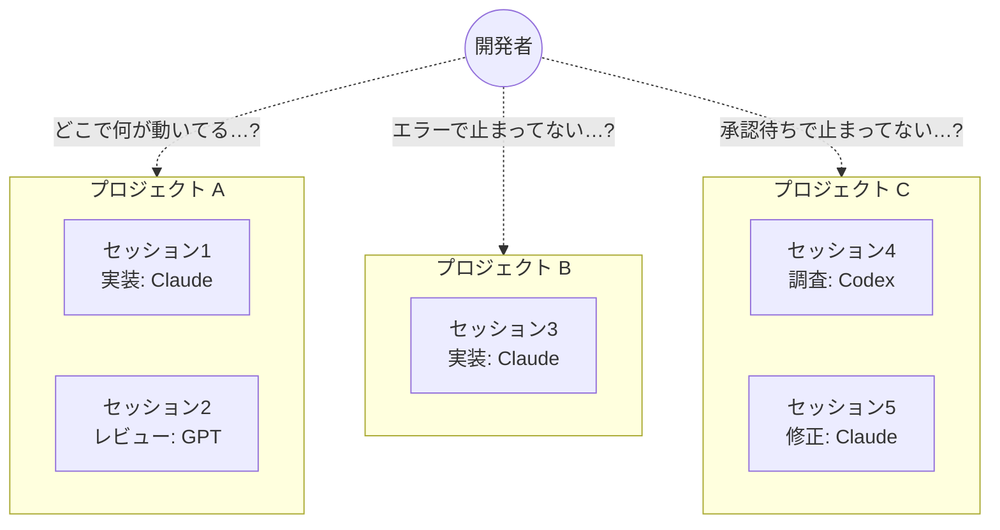
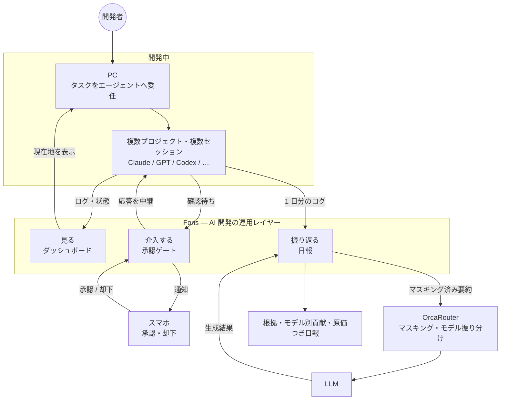
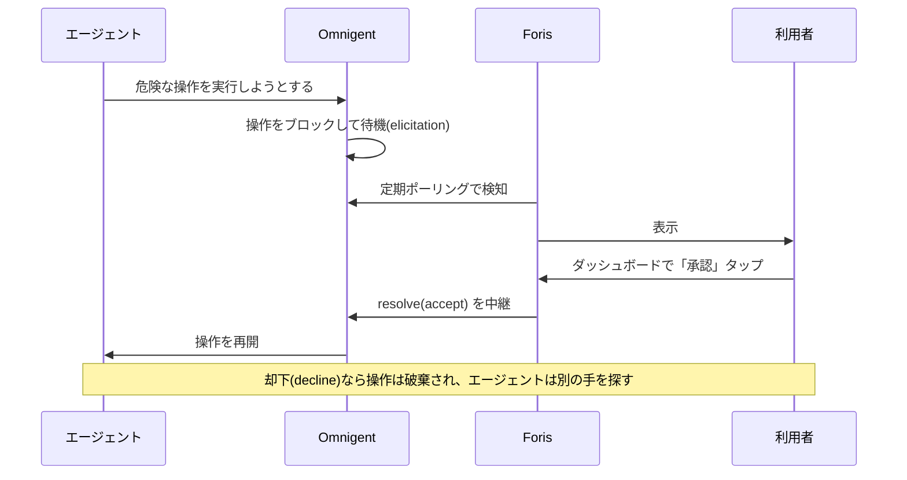
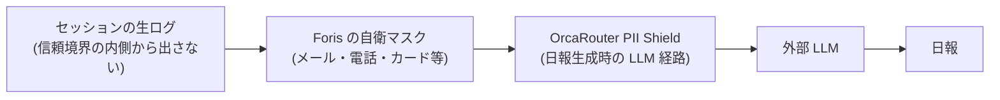
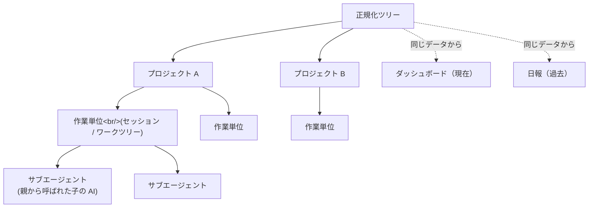
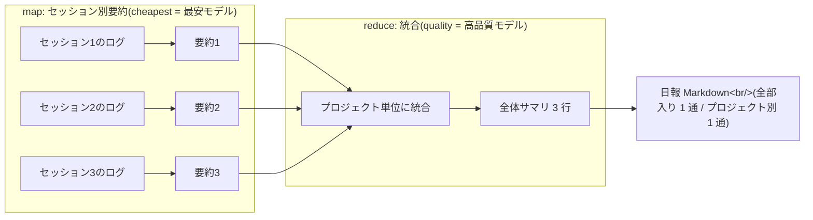

本記事は、AI HACK ハッカソン 2026 に提出したプロダクト **Foris** の紹介と、その設計についてです。

Foris は、OrcaRouter を活用し、複数の AI エージェント作業を「見る・介入する・振り返る」ための運用レイヤーを実装したプロダクトです。

デモ動画 : 

https://youtu.be/sQ0TlcLityg?si=6zFA_5AcmterckIV

## 1. 背景

AI エージェントに任せられる開発タスクの単位は大きくなり、開発者は 1 つのセッションを見守るだけでなく、複数の作業を並行して任せるようになりました。

METR は、AI エージェントが一定の成功率で完了できるタスクの規模を、人間の熟練者が要する時間で測定しています。近年の計測では、この指標は時間単位まで伸びており、エージェントに任せる仕事の単位が大きくなっていることが示されています。[^1]

実装は Claude、レビューは GPT、調査は別のエージェント、といったように、モデルごとに役割を分けることも珍しくありません。複数のプロジェクト・セッション・モデルが同時に動く環境では、課題は AI を動かすことそのものから、動いている AI の仕事を人間がどう運用するかへ移ります。

### 1-1. 離席中、人の判断待ちで作業が止まる

エージェントは、危険な操作や追加の判断が必要になったとき、人間の確認を待って停止します。これは安全な挙動ですが、開発者が離席している間に確認待ちになれば、そのセッションは進みません。

複数の作業を任せるなら、人間が常に画面を見張るのではなく、判断が必要になったときだけ気づき、その場で承認・却下できる状態が必要です。安全性を保ちながら、離席している間も、判断を必要としない作業を滞りなく進められるようにしたいと考えました。

### 1-2. 作業中、複数のエージェントを見渡せない

1 人の開発者が、複数プロジェクトで複数のエージェントを並行して動かすと、作業はすぐに分散します。実装中のセッション、レビュー中のセッション、調査中のセッションが、それぞれ異なるプロジェクト・作業ディレクトリ・セッション・モデルで動く状態です。

このとき必要なのは、ログを一覧で眺めることではありません。どのエージェントがどこで何をしているか、順調に進んでいるか、エラーや承認待ちで止まっていないかを、1 か所で把握できることです。

### 1-3. 作業後、成果と経緯を1日の単位で振り返れない

成果物や作業の記録は、コミットや Pull Request、チケット、ドキュメントなどに断片的に残ります。しかし、それだけでは、その日に進んだ作業の全体像はわかりません。

たとえば、どのエージェントがどの作業を担当したのか、何を試して失敗したのか、どのように復旧したのか、レビュー役の AI が出した指摘のうち何を採用したのか。こうした判断や試行錯誤は、各ツール・各セッションのログに分散しています。

作業の終わりには、成果物だけでなく、その成果に至る経緯も含めて、「今日、自分とエージェントで何を進めたのか」を短時間で振り返りたいと考えました。

---

課題はログが存在しないことではなく、複数のツール・モデル・セッションに分散した情報を、人間が現在の判断と後からの振り返りに使える形へ変換できていないことです。

Foris は、この課題に対して、作業中は全体を見渡し、必要なときだけ介入し、作業後には成果を振り返るための運用レイヤーを提供します。

## 2. Forisが提供すること

Foris の目的は、複数の AI エージェントが並走する開発を、人間が「見る・介入する・振り返る」ことができる状態にすることです。

そのために、ツールやセッションごとに分散したログを収集・整理し、作業中の状況把握から、必要なタイミングでの判断、作業後の日報作成までを一貫して支援します。

| 困りごと | 機能 | 何をするか |
|------|------|-----------|
| 離席中、判断待ちで作業が止まる | 承認ゲート | 確認待ちをスマホへ通知し、外出先から許可・却下できるようにする。人間の判断を待つ時間を短くする |
| 作業中、どこで何が動いているか見渡せない | ダッシュボード | 全プロジェクトのセッションの現在地を 1 画面で俯瞰する。エラー・承認待ちなど、対応が必要な状態を優先して表示する |
| 作業後、成果と経緯を振り返られない | 日報 | 1 日分のログを集約し、成果・試行錯誤・モデルごとの貢献をMarkdown の日報としてまとめる |

## 3. プロダクト全体像

Foris は、複数の AI エージェントが並走する開発に「見る・介入する・振り返る」ための運用レイヤーを加えるプロダクトです。同じ作業ログから、作業中のダッシュボード、離席中の承認操作、作業後の日報を提供します。

- 作業中: ダッシュボードで、複数のエージェントがどこで何をしているかを見渡す
- 離席中: 承認が必要になったときだけスマホへ通知し、人間が判断する
- 作業後: 分散したログを統合し、成果と経緯を日報として振り返る

この体験の基盤として、Foris は Omnigent からセッションログと承認待ち状態を取得します。日報生成時の LLM 呼び出しは OrcaRouter を経由し、マスキングとモデルの振り分けを行います。各技術をどの機能にどう使っているかは、次章で紹介します。

## 4. Foris の3つの機能

Foris は、エージェントの作業ログをただ集めるだけではなく、作業中・離席中・作業後のそれぞれで使える形に変換します。ここでは、開発者が Foris でできる3つのことを紹介します。

### 4-1. ダッシュボード : 今何が動いているか、複数のエージェントを一画面で見渡す

ダッシュボードでは、複数プロジェクトで動くセッションを横断して確認できます。実装・レビュー・調査などの作業がどこで進んでいるかに加え、エラーや承認待ちなど、対応が必要な状態を優先して表示します。

単にログを時系列に並べるのではなく、プロジェクト・作業単位・サブエージェントの階層で整理することで、複数の作業が同時に走っていても全体像を把握しやすくしています。ダッシュボードと日報は同じ整理済みのログを参照するため、「いま見えている状態」と「あとから振り返る記録」が食い違いません。

### 4-2. 承認ゲート : 判断が必要なときだけ介入する
エージェントが危険な操作や追加の判断を求めたとき、Foris はその確認待ちをスマホで扱えるようにします。開発者は離席中でも、承認・却下の2択で応答できます。

安全のために必要な停止は維持しつつ、判断待ちに気づかないことで作業全体が滞る時間を減らします。スマホからの操作を承認・却下に絞ることで、小さな画面でも意図しない指示を送りにくい設計にしました。

承認画面は PWA として提供しています。Web ページをホーム画面に追加するだけで使えるため、専用アプリのインストールなしに、必要なときだけスマホから判断できます。

### 4-3. 日報生成 : 1日の成果と経緯を根拠付きで残す

日報では、分散したセッションログを統合し、「今日、自分とエージェントで何を進めたか」を Markdown にまとめます。成果の要約だけでなく、どのモデルがどの作業に関わったか、どの程度のコストがかかったかも記録します。

日報の文章を生成する際は、セッションごとの要約には低コストなモデルを使い、全体の統合には高品質なモデルを使います。日報生成時の LLM 呼び出しは OrcaRouter を経由させ、用途に応じたモデルの振り分けを行います。

#### 秘密情報を外に出さない
エージェントのログには、エラーメッセージ中のメールアドレスなど、秘匿情報が混ざる可能性があります。そのため、生ログをそのまま外部 LLM に渡しません。Foris 側の正規表現によるマスキングと、OrcaRouter の PII Shield によるマスキングを重ね、メールアドレス・電話番号・マイナンバー・カード番号などを `[PII:種別]` に置き換えます。

#### 日報の生成原価を可視化する
生成された日報の末尾には、生成にかかった原価を実測値で記録します。

> この日報の生成原価: $0.0123（実測 / cheapest 62% / quality 38% / 総 45,678 tokens）

OrcaRouter の応答に含まれる実トークン数とモデル別の単価表を用いることで、推定値ではなく実際の利用量に基づいて算出します。日報そのものに原価を残すことで、要約の品質だけでなく、低コストなモデルへの振り分けが有効に働いているかも確認できます。

## 5. 機能を支える設計

### 5-1. Omnigent の統一ログを、Foris の共通データモデルに変換する

Omnigent は、複数のエージェントを並走させ、全セッションを横断する統一ログ API と、確認待ちを扱う仕組みを提供する OSS です。Foris はこの基盤を利用して、エージェントを新たに作り直すのではなく、収集されたログを「見渡せる」「振り返れる」形に変換する役割に集中しました。

Omnigent の API が返すセッション一覧はフラットです。そのまま時系列に並べても、複数の作業が同時に走る状況では全体像をつかめません。そこで Foris は、ログをプロジェクト・作業単位・サブエージェントの3階層に正規化し、ダッシュボードと日報の両方をこの共通データモデルから生成します。

プロジェクトに明示的に紐づかないセッションは、まず作業ディレクトリのパスを手がかりにまとめます。Git を使っている場合はブランチ名も補助情報として利用しますが、Git は必須入力ではありません。これにより、情報の欠けた突発的なセッションも、すべてが1つの分類に落ちることを避けています。

### 5-2. 日報は、AI による文章化と機械集計を分けて作る

1日分のログを一度にモデルへ渡すと、文脈が長くなり、コストも品質も安定しません。Foris では、大量データ処理の map-reduce に倣い、まずセッションごとに並列で要約し、その後にプロジェクト単位・全体へと統合します。

ここで、AI はログを読みやすい文章にする役割だけを担います。モデルごとの利用量、ツール実行回数、エラーの有無といった事実の帰属は、セッションの構造データから機械的に集計します。文章化と事実集計を分けることで、もっともらしい推測が日報の数値や貢献情報に混ざることを防ぎます。

要約のプロンプトには実ログの抜粋を添え、「ログにないことは推測で書かない」と指示します。長いログは、依頼内容が現れやすい先頭と、結果が現れやすい末尾を優先して残します。

### 5-3. OrcaRouter を、安全で低コストな日報生成経路にする

日報生成時の LLM 呼び出しは、すべて OrcaRouter を経由させます。これにより、セッションごとの要約には cheapest、全体の統合には quality を指定し、処理ごとに品質とコストのバランスを取れます。

外部 LLM に渡す前には、Foris 側でメールアドレス・電話番号・マイナンバー・カード番号などを正規表現で置き換えます。さらに OrcaRouter の PII Shield を通すことで、アプリ側とルーター側の二層でマスキングします。4章で紹介した日報の安全性は、この日報生成経路を1か所に集約することで保っています。

日報の原価は、OrcaRouter の応答に含まれる実トークン数とモデル別の単価表から算出します。単価は、プロバイダー解決後の応答モデル名ではなく、リクエスト時に指定したモデル ID で参照します。これにより、ルーティング後のモデル名の揺れで原価計算が欠けることを防いでいます。

### 5-4. 依存先が利用できなくても、日報の骨格を返す

Foris は Omnigent と OrcaRouter という外部サービスに依存しています。そのため、どちらかが一時的に利用できなくなっても、何が起きているかを隠さず、可能な範囲で結果を返すようにしました。

- LLM が不通でも日報を返す
    - 要約呼び出しはセッションごとに失敗を吸収し、失敗した部分には「（要約なし）」と明記します。構造データから集計できる成果・利用量などは残し、縮退中であることも日報の冒頭で知らせます。

- API キーがなくても開発できる
    - キー未設定時は決まった応答を返すモックに切り替え、チーム全員が実キーなしで動作確認とテストを行えます。

- 上流サービスの不調を区別する
    - 接続先で起きた問題は「上流のエラー」として扱い、原因不明の 500 エラーに埋もれないようにします。

## 今後の展開

- **収集経路の拡充**: Omnigent を経由しない素の CLI ログ(JSONL)や git からも直接収集する二段構えの完全実装
- **通知チャネルの拡充**: Slack/Discord への配信
- **期間ロールアップ**: 日報の積み上げから、週報・査定期の実績を自動生成

## まとめ
AI エージェントに任せる作業が増え、複数のモデル・プロジェクト・セッションが並走する開発では、「AI を動かす」だけでは不十分になりました。人間には、現在の状況を見渡し、必要なときだけ安全に介入し、作業後に成果と経緯を振り返るための運用レイヤーが必要です。

Foris は、分散したエージェントログを共通のデータモデルへ整理し、ダッシュボード・承認ゲート・日報として提供します。日報では、文章化を LLM に任せる一方で、モデル別の利用量やコストなどの事実は構造データから集計します。さらに、日報生成の経路にマスキングと原価計測を組み込み、安全性と運用コストの両方を扱えるようにしました。

今後は、Omnigent を経由しない CLI ログや、利用可能な場合の Git 情報も取り込み、より多様な AI 開発環境を横断して扱えるようにしていきます。

---
このハッカソンにおいて、同時に執筆した記事がありますので、合わせてご覧いただけますと幸いです

- [Forisのより技術者向け記事](https://qiita.com/arishow/items/200dfd5beaf07044440f)
- [OrcaRouterの始め方について](https://qiita.com/arishow/items/759908c62d1b0fe29f04)
- [OrcaRouterのPII周りの検証記事](https://qiita.com/arishow/items/965b465fe163955d2aea)
[^1]: [METR, Task-Completion Time Horizons of Frontier AI Models](https://metr.org/time-horizons/)
